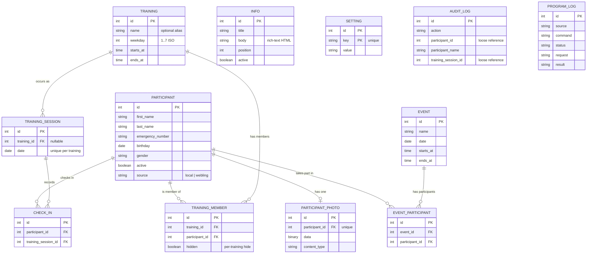

# Overview

All application state lives in one SQLite database. There are two independent
"worlds": the **recurring training** world (members, dated sessions, check-ins)
and the **one-off event** world (hand-picked participants). A participant is the
hub both connect to; content (`infos`) and tunables (`settings`) plus the two
log tables hang off to the side.

# Entity-relationship graph

`INFO`, `SETTING`, `AUDIT_LOG`, and `PROGRAM_LOG` have no foreign keys and are
drawn without edges: they are intentionally unconstrained (settings are a
generic key/value store; log rows keep a denormalised copy so they survive the
deletion of the participant or session they mention).

# Reading the graph

**Membership vs. attendance.** `TRAINING_MEMBER` and `CHECK_IN` answer
different questions. A *member* (imported from user management, or added on
first check-in) belongs to the training as a whole — a stable relationship, and
the one that carries the per-training `hidden` flag. A *check-in* is attendance
at one concrete dated `TRAINING_SESSION`, so the same participant has many
check-ins over time. The kiosk lists members by default and shows everyone under
"show all" (see [Web layer](/architecture/web-layer.md)).

**Recurring vs. one-off.** A `TRAINING` is a weekly rule (weekday + times); the
dated `TRAINING_SESSION` rows are generated on demand from that rule, so
`TRAINING_SESSION.training_id` is nullable — a session with no training is an
ad-hoc day. An `EVENT` skips the rule and the sessions entirely: it is a single
dated row whose participants are chosen explicitly through
`EVENT_PARTICIPANT`, the event-side twin of `TRAINING_MEMBER` (without a hidden
flag). See [Events](/architecture/events.md).

**Uniqueness.** The join tables are unique per pair
(`training_members(training_id, participant_id)`,
`event_participants(event_id, participant_id)`,
`check_ins(participant_id, training_session_id)`), one `TRAINING_SESSION` per
training per date, one `PARTICIPANT_PHOTO` per participant (stored in the
database, not on disk — see [Web layer](/architecture/web-layer.md)).

**Deletion.** Photos, memberships, check-ins, and event selections cascade from
their parent (`on_delete: :delete_all`), while the audit/program logs do not —
they keep their denormalised names so history is never lost.

See also [Domain model](/architecture/domain-model.md),
[Domain logic](/architecture/domain-logic.md), and the
[Directory map](/architecture/directory-map.md).
